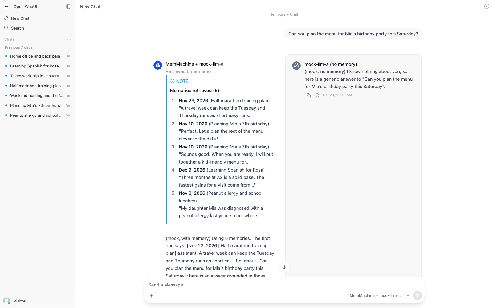
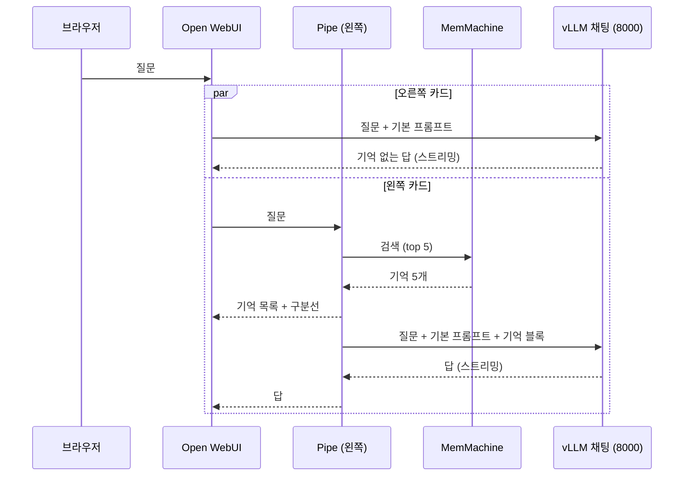
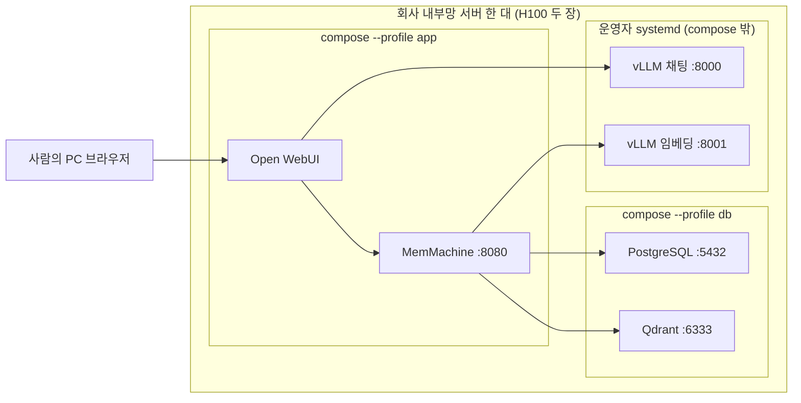
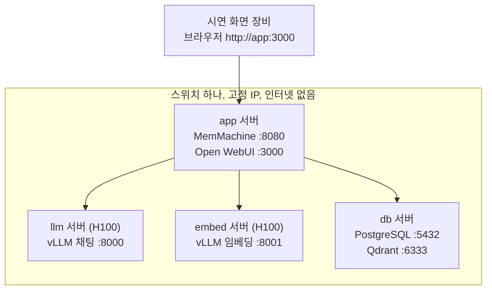
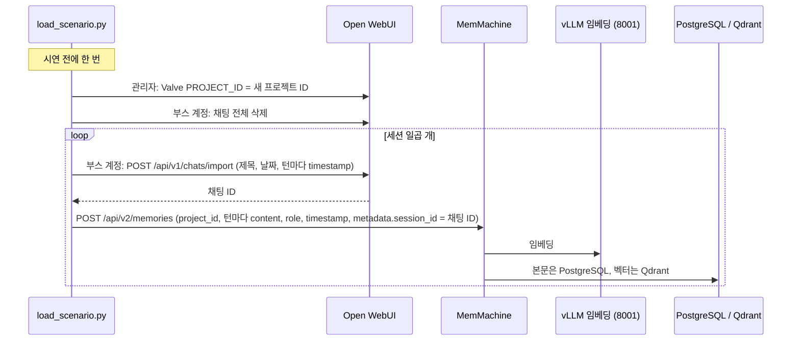
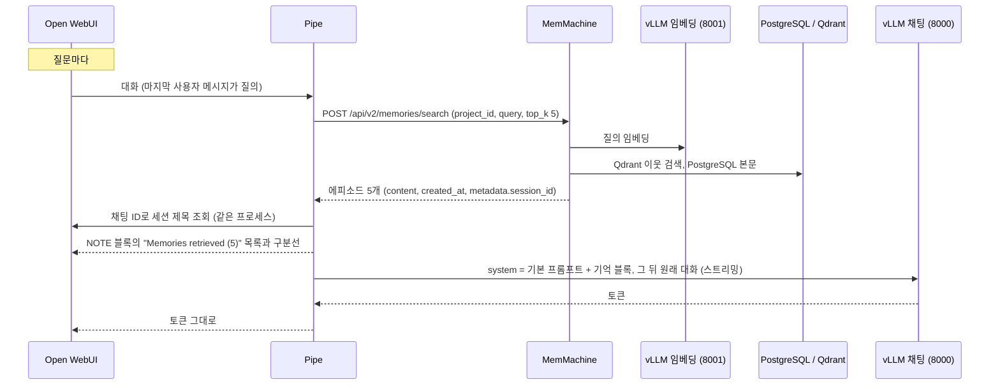

# CES 2027 MemMachine 데모 아키텍처: 회사 검증과 부스 시연

- 작성일: 2026-10-27
- 대상: 데모의 전체 그림을 처음 보는 사람(1부), 그리고 회사 검증을 이어받거나 부스를 준비하는 사람(2부)
- 근거 문서: [설계](design_2026-10-26.md), [회사 실행서](company_runbook_2026-10-27.md), [사용 가이드](guide_2026-10-27.md), [이전 절차서](relocation_2026-10-27.md), [Mac 검증 기록](verification_mac_2026-10-27.md), 회사 검증 결과는 GitHub 이슈 [#45](https://github.com/taejin-oh/MemMachine/issues/45)
- 대상 커밋: `msr_ces2027_demo` 브랜치의 `181f190e`(2026-10-28: 기억 없는 모델도 Pipe, "No memory used" 줄, MAX_TOKENS, 한 줄 미리보기, 와이드 모드). 그 앞의 `c79f44ec`(초기화 스크립트, 모니터, `restart: always`), 그 앞의 `008480a6`(기억 목록 두 줄, NOTE 블록, 임시 채팅 기본값, 로고 아바타)과 리뷰 반영 커밋을 포함한다

## 0. 요약

데모는 Open WebUI의 모델 비교 화면에서 같은 질문에 대한 두 답을 나란히 보여 준다. 왼쪽은 MemMachine이 과거 대화에서 찾은 기억 다섯 개를 먼저 보여 주고 그 기억으로 답하며, 오른쪽은 같은 LLM이 기억 없이 답한다. Open WebUI와 MemMachine의 소스는 고치지 않았고, 브랜치에는 Pipe 함수 하나, compose 파일 하나, 설정 파일 하나, 스크립트 다섯, 대본 하나가 들어 있다.

같은 파일로 세 환경을 돈다. Mac에서는 가짜 LLM(mock)으로 개발하고, 회사 서버에서는 실제 vLLM으로 검증하며, 부스에서는 서버 네 대로 시연한다. 장소마다 다른 값은 `deploy/.env` 한 파일에만 있다.

회사 검증은 2026년 10월 27일 내부망 서버 한 대에서 끝까지 통과했다. 운영자가 systemd로 띄워 둔 vLLM 두 대를 그대로 쓰고, MemMachine은 공개 이미지를 썼다. 검증 중에 나온 다섯 가지 발견은 모두 코드와 문서에 반영했고, 그 뒤 부스 화면을 일반 계정으로 바꿔 불필요한 기능을 없앴다. 부스는 서버 네 대와 시연 장비를 스위치 하나로 묶은 오프라인 망이며, 한국에서 세팅과 리허설을 마치고 미국에서는 전원과 배선만 복구한다.

---

# 1부. 보기 쉬운 버전

## 1.1 무엇을 보여 주나

스태프가 "이번 토요일 Mia 생일 파티 메뉴를 짜 줘"처럼 과거 대화 여러 개를 알아야 답할 수 있는 영어 질문을 입력한다. 왼쪽 카드에는 "Nov 3, 2026 (Peanut allergy and school lunches)"처럼 날짜와 세션 제목이 붙은 기억 다섯 개가 먼저 뜨고 그 아래 답이 나온다. 오른쪽 카드에는 같은 LLM이 질문만 보고 쓴 일반론 답이 나온다. 관객이 원하면 사이드바의 과거 채팅을 열어 왼쪽 목록의 문장이 실제로 그 대화에 있었음을 보여 준다.

과거 대화는 미리 적어 둔 대본이다. 일곱 세션 서른두 턴이 2026년 11월과 12월 날짜로 Open WebUI의 사이드바와 MemMachine의 기억에 똑같이 들어가 있다. 시연 중에는 아무것도 저장하지 않으므로 같은 질문을 몇 번 해도 같은 기억이 나온다.

## 1.2 다섯 가지 구성 요소

| 구성 요소 | 하는 일 | 어디에 있나 |
|---|---|---|
| Open WebUI (v0.12.4 공식 이미지) | 채팅 화면. 두 모델을 동시에 부르고 답을 나란히 그린다 | 앱 서버의 컨테이너 |
| MemMachine Pipe (파이썬 파일 하나) | 왼쪽 모델. 질문으로 MemMachine을 검색해 목록을 먼저 쓰고, 기억을 넣은 프롬프트로 LLM을 부른다 | Open WebUI 안에 함수로 설치 |
| MemMachine (공개 이미지 `0.4.1-dev1`) | 기억 저장과 검색. 질문을 임베딩해 Qdrant에서 이웃을 찾고 PostgreSQL에서 본문을 읽는다 | 앱 서버의 컨테이너 |
| PostgreSQL과 Qdrant | 기억의 본문과 벡터 | DB 서버의 컨테이너 |
| vLLM 두 대 | 채팅 모델(포트 8000)과 임베딩 모델(포트 8001) | GPU 서버. 부스에서는 서버 두 대, 회사에서는 운영자가 띄운 서버 |

## 1.3 질문 하나가 처리되는 길

양쪽은 같은 LLM, 같은 기본 프롬프트, 같은 질문을 받는다. 다른 것은 기억 블록의 유무뿐이다. MemMachine은 검색할 때 임베딩 vLLM(포트 8001)을 한 번 부른다.

## 1.4 회사 검증은 어떻게 했나

회사에서는 서버 한 대에 모든 역할을 올렸다. 운영자가 systemd로 상시 서빙하는 vLLM 두 대가 이미 있어서 데모 compose의 GPU 프로필은 쓰지 않았고, 데이터베이스와 앱만 컨테이너로 올렸다.

진행은 [회사 실행서](company_runbook_2026-10-27.md)의 순서를 그대로 따랐다.

1. 작업표를 채운다(IP, 모델, 계정).
2. 브랜치를 clone하고 `.env`를 쓴다.
3. 임베딩 차원을 가중치에서 읽어 설정에 적는다.
4. db 프로필, app 프로필 순서로 올린다. vLLM은 이미 떠 있으므로 `curl`로 조건만 확인한다.
5. 세팅, 적재, 검사 스크립트를 순서대로 돌린다.
6. 브라우저로 화면을 보고, 답이 시작되는 시간을 재고, 결과를 문서로 남긴다.

결과는 통과다. healthcheck가 있는 컨테이너 셋이 healthy, Qdrant는 Up이었고 검사 스크립트의 모든 줄이 OK였다. 왼쪽 카드의 기억 목록은 0.13초에 떴고 오른쪽 답은 3.7초에 시작했다. 통과 과정에서 나온 다섯 가지 발견(빌드 불가, Qdrant 워커 폭주, 운영자 서빙 조건 누락, 공개 이미지 계보, 임베딩 차원 함정)은 모두 반영했다(2.3절).

## 1.5 부스에서는 어떻게 하나

부스에는 서버 네 대와 시연 화면 장비를 스위치 하나로 묶는다. 인터넷은 없다.

한국에서 할 일은 회사 검증과 같은 순서로 네 대에 올리고, 대본을 적재하고, 인터넷 선을 뽑은 채 전체를 껐다 켜서 검사 스크립트가 통과하는지 보는 것이다. 그 상태로 전원을 끄고 옮긴다. 미국에서 할 일은 배선 복구, 전원 켜기, 검사 스크립트 실행, 브라우저 열기 네 가지다. 모든 컨테이너는 부팅 때 저절로 뜨고, 데이터는 디스크 볼륨에 남는다.

시연 화면은 부스용 일반 계정(`visitor@demo.local`)으로 들어간다. 입력창에는 보내기 단추와 모델 선택만 있고, 첨부와 마이크와 컨트롤 단추는 없다. 스태프는 대본의 질문 넷만 입력한다. 새 채팅은 임시 채팅으로 열리므로 관객의 질문은 저장되지 않고, 다음 관객 때는 New Chat만 누르면 사이드바가 적재한 과거 채팅 그대로다. 왼쪽 카드의 기억 목록은 파란 NOTE 블록 안에 기억마다 한 줄로 나온다.

## 1.6 회사 검증과 부스의 차이

| 항목 | 회사 검증 (2026-10-27) | 부스 |
|---|---|---|
| 서버 | 한 대에 모든 역할 | 네 대(llm, embed, app, db) |
| vLLM | 운영자가 systemd로 상시 서빙. compose의 llm, embed 프로필 미사용 | compose의 llm, embed 프로필로 올린다 |
| 인터넷 | 있음(TLS 검사 망). 이미지를 여기서 받는다 | 없음. 이미지와 가중치는 미리 디스크에 둔다 |
| 목적 | 실제 모델에서 동작과 검색 품질과 응답 시간 확인 | 리허설과 시연 |
| 같은 것 | compose 파일, MemMachine 설정, Pipe, 스크립트, 대본. `.env`의 값만 다르다 | |

---

# 2부. 상세 버전

## 2.1 회사 검증 환경

| 항목 | 값 |
|---|---|
| 서버 | 내부망 서버 한 대. H100 PCIe 두 장, 344코어, 1TB RAM, Ubuntu 24.04.3 |
| Docker | Docker 29.1.3, Compose 2.40.3 |
| 채팅 모델 | `Qwen/Qwen3.6-35B-A3B-FP8`, 포트 8000. 운영자의 root systemd 유닛(`vllm@.service`)이 서빙. 검증 뒤 `--default-chat-template-kwargs '{"enable_thinking": false}'`로 다시 띄웠다 |
| 임베딩 모델 | `Qwen3-Embedding-8B`, 포트 8001, 1024차원. `--hf-overrides '{"is_matryoshka": true}'`로 `dimensions` 인자를 받는다 |
| MemMachine | 공개 이미지 `memmachine/memmachine:0.4.1-dev1` (digest `sha256:e0206353…`). 브랜치에서 빌드하지 않는다 |
| Open WebUI | v0.12.4 공식 이미지. 공개 포트는 `.env`의 `OPENWEBUI_PORT` |
| 데이터베이스 | `pgvector/pgvector:pg16`, `qdrant/qdrant:v1.19.0` |
| compose 프로필 | 같은 호스트에서 `db` 다음 `app`. `llm`, `embed`는 올리지 않는다 |
| 스크립트 실행 위치 | 같은 서버. `.env`의 `APP_HOST`, `DB_HOST`, `LLM_HOST`, `EMBED_HOST`가 모두 이 서버의 내부망 IP다 |

운영자 서빙 모양에서 운영자 쪽이 지켜야 할 조건은 실행서 2.4절에 표로 있다. 요지는 채팅 vLLM이 8000에서 `<LLM_MODEL_NAME>` ID로, 임베딩 vLLM이 8001에서 정확히 `embed` ID와 `--runner pooling`으로 떠 있어야 하고, 임베딩 서버가 `dimensions` 인자를 받아야 한다는 것이다. 데모 쪽 파일은 이 이름과 포트를 고정값으로 쓰고, 조건이 어긋나면 데모 파일을 고치지 않고 서버 쪽을 맞춘다.

## 2.2 회사 검증의 구조

검증은 사람 또는 Claude Code 세션이 [회사 실행서](company_runbook_2026-10-27.md) 한 문서를 위에서 아래로 수행하는 구조다. 단계마다 **하는 일**, **명령**, **나와야 하는 것**, **다르면**의 네 칸이 있고, 나와야 하는 것이 안 나오면 다음으로 가지 않는다.

| 장 | 하는 일 | 산출물 |
|---|---|---|
| 2장 작업표 | 서버 IP와 역할, 모델 경로와 이름, 임베딩 차원, 계정 비밀번호를 표로 채운다 | `.env`에 들어갈 값 |
| 3장 에이전트 규칙 | 세션이 지킬 것. 다른 서버로 ssh하지 않고, 볼륨을 지우지 않고, 비밀번호를 출력하지 않는다 | |
| 4장 코드 받기 | `git clone --branch msr_ces2027_demo --single-branch --depth 1` 또는 기존 clone에 worktree | `~/ces2027/MemMachine` |
| 5장 서버마다 준비 | 프로그램과 GPU 확인, 가중치의 `config.json`에서 임베딩 차원 읽기, `memmachine.yml`의 `dimensions` 수정, `.env` 쓰기, compose 문법 확인 | `.env`, `memmachine.yml` |
| 6장 올리기 | db, embed, llm, app 순서. 역할이 없는 서버의 절은 건너뛴다. 운영자 서빙이면 embed와 llm은 `curl`만 한다 | healthy 컨테이너, 검사 통과 |
| 7장 화면과 시간 | 브라우저로 네 질문, API로 첫 토큰 시간, vLLM 요청 로그로 내장 도구 차단 확인 | 시간표, 판정 |
| 8장 결과 남기기 | `verification_company_<날짜>.md`를 쓰고 커밋해 push | 검증 문서 |
| 9장 보고 | 사람에게 보낼 요약 양식 | |
| 10장 문제 찾기 | 증상, 원인, 조치 표 | |

6장의 app 절에서 세 스크립트가 돈다. 모두 표준 라이브러리만 쓰는 파이썬이며 `.env`를 읽는다.

| 스크립트 | 로그인 | 하는 일 |
|---|---|---|
| `setup_openwebui.py` | 관리자(첫 실행 때 가입으로 생성) | Pipe 함수 설치와 활성화, Valve 기록, 네 모델 항목(즉시 둘과 단계별 둘. 표시 이름, 아바타, 내장 도구와 첨부 차단, 모든 계정의 읽기 권한)과 옛 `LLM_MODEL_NAME`의 항목 제거, 부스 계정 생성, 두 계정의 조용한 설정 |
| `load_scenario.py` | 관리자(Valve)와 부스 계정(채팅) | 새 프로젝트 ID `ces-<날짜>-<시각>`을 Valve에 쓰고, 부스 계정의 채팅을 모두 지운 뒤 대본의 일곱 세션을 날짜와 시각 그대로 가져오고, 같은 턴을 MemMachine 에피소드로 저장 |
| `demo_check.py` | 관리자(Valve)와 부스 계정(모델 목록) | 서버 여섯 곳 응답, 부스 계정에 네 모델 보임, 채팅 모델이 서빙됨, 질문 넷의 기대 문구가 top-5에 듦, 녹음 Valve 꺼짐, 기억 모델과 기억 없는 모델과 단계별 모델에서 답 하나씩 |
| `demo_reset.sh` | 위 세 스크립트를 부른다 | 이 서버의 컨테이너를 다시 만들고(`--wipe`면 볼륨도 지운 뒤) healthcheck를 기다리고, 앱 서버면 세팅, 적재, 검사를 이어서 실행 |
| `demo_monitor.py` | 없음 | 서버 여섯 곳과 이 서버의 컨테이너 상태를 몇 초마다 표시, 바뀐 줄을 로그에 기록, 실행 중인 unhealthy 컨테이너 재시작 |

검사 스크립트의 통과 기준은 설계 2장의 성공 기준과 같다. 대본 질문마다 기대 기억이 top-5에 들고, 녹음 모드가 꺼져 있고, 한 질문이 Pipe를 거쳐 답까지 온다.

## 2.3 회사 검증의 진행과 결과 (2026-10-27)

clone부터 통과까지 약 3시간 15분이 걸렸다. 결과는 다음과 같다.

| 항목 | 결과 |
|---|---|
| 컨테이너 | postgres, memmachine, openwebui healthy, qdrant Up(healthcheck 없음, 검사 스크립트가 포트로 확인) |
| 스크립트 | 세팅, 적재, 검사 완료. 프로젝트 `ces-20261027-042336`, 일곱 세션 마흔 턴 |
| 검사 출력 | 모든 줄 OK, 마지막 줄 `all checks passed` |
| 시간(스트리밍 첫 내용 기준) | 왼쪽 기억 목록 0.13초, 왼쪽 답 끝 16.40초. 오른쪽 첫 토큰 3.69초, 답 끝 4.85초 |
| 판정하지 못한 것 | 7.3절의 요청 로그 확인. 운영자 vLLM에 `--enable-log-requests`가 없어 프롬프트가 로그에 남지 않았다. 오른쪽 답이 모두 "과거를 모른다"는 일반 답인 것으로 간접 확인했다 |

통과 과정에서 다섯 가지 발견이 나왔고 다음과 같이 반영했다.

| 발견 | 원인 | 반영 (커밋) |
|---|---|---|
| 브랜치의 MemMachine 이미지가 빌드되지 않음 | 회사 망의 TLS 검사. 빌드 컨테이너의 uv가 사내 CA를 모른다 | 빌드하지 않기로 결정. compose가 공개 이미지를 직접 쓰고 `memmachine.yml`에 그 이미지가 요구하는 `collection_registry: postgres`를 넣었다 (`98be86d7`) |
| Qdrant가 OOM과 파일 디스크립터 고갈로 죽음 | 코어 수(344)만큼 워커를 띄운다 | `QDRANT__SERVICE__MAX_WORKERS=8`, 메모리 상한 2g (`98be86d7`) |
| 운영자 서빙 모양이 문서에 없음 | 실행서가 compose 프로필만 전제 | 실행서 2.4절 조건표, 6.2와 6.3의 `curl` 주소, 7.3의 미판정 분기, `.env.example` 주석 (`72d6c622`) |
| 공개 이미지는 speedkick 코드와 계보가 다름 | 빌드 대신 공개 이미지를 씀 | 공식 결정으로 바꾸고 보고서 템플릿에 digest와 커밋을 적게 했다. 이미지 계보가 바뀌면 Postgres 스키마가 달라 적재가 실패하므로 볼륨을 비우는 절차를 적었다 (`72d6c622`, `3855299d`) |
| `dimensions`를 거부하는 임베더면 첫 적재가 500 | Qdrant 컬렉션은 설정값 차원으로 만들어지고 재시도는 모델 기본 차원을 돌려준다 | 설계 A.21 정정, 실행서 6.2의 통과 조건을 "`dimensions`를 붙인 요청이 성공한다"로 변경 (`72d6c622`, `3855299d`) |

반영하지 않은 것도 있다. 대본 질문 1과 2의 문장을 바꾸자는 제안은 원문 유지로 결정했다. 그래서 실제 임베더로 다시 검사하면 그 두 질문의 `top-5` 줄이 `FAIL`일 수 있고, 그때는 실행서 6.4절대로 검색 결과를 보고 사람이 정한다. 회사 서버에서 적용한 미커밋 변경(메모리 상한 16g, `memmachine.yml`의 모델 이름 임시 변경, 대본 문장)은 다음 pull 때 버린다. 절차는 이슈 #45의 댓글에 있다.

검증 뒤에 한 가지를 더 바꿨다. 회사 화면에 `ask_user` 도구 블록이 보였다는 보고가 있었는데, 코드상 세팅 도구가 만든 모델 항목에는 내장 도구가 갈 수 없으므로(`capabilities.builtin_tools=false`이면 도구 목록을 만드는 함수가 불리지 않는다) 항목이 없는 모델로 채팅한 것이다. 이와 별개로 관리자 계정에는 Open WebUI가 기능 제한을 적용하지 않아 화면을 단순하게 만들 수 없었다. 그래서 부스 화면이 로그인할 일반 계정을 두고 그 계정의 권한을 환경 변수로 껐다(`76746a02`, `0d327c8c`). 일반 계정에는 항목이 있는 두 모델만 보이므로 `ask_user` 경우도 함께 사라진다. Mac에서 검증했고 회사 서버에서는 다음 pull 뒤에 다시 검사한다.

## 2.4 데모 구조 상세

### 2.4.1 네트워크와 이름

모든 설정은 IP 대신 네 호스트 이름을 쓴다. 컨테이너 안에서는 compose의 `extra_hosts`가 `.env`의 IP로 풀고, 시연 장비는 `/etc/hosts`에 같은 대응을 넣는다. 스크립트는 `.env`의 IP를 직접 쓴다. Mac에서는 IP 자리에 `host-gateway`를 적어 Mac 자신에 공개된 포트로 간다.

| 이름 | 역할 | 포트 | 누가 부르나 |
|---|---|---|---|
| `llm` | vLLM 채팅 모델 | 8000 | Open WebUI(오른쪽 모델), Pipe(왼쪽 모델) |
| `embed` | vLLM 임베딩 모델, 서빙 이름 `embed` | 8001 | MemMachine |
| `app` | MemMachine, Open WebUI | 8080, 3000 | Pipe가 MemMachine을, 브라우저가 Open WebUI를 |
| `db` | PostgreSQL, Qdrant | 5432, 6333(HTTP), 6334(gRPC) | MemMachine |

LLM과 임베더의 포트를 다르게 둔 것은 회사처럼 H100 두 장이 한 서버에 있을 때 compose 파일을 고치지 않기 위해서다.

### 2.4.2 컨테이너와 프로필

compose 파일은 하나이고, 서비스마다 `profiles`로 속한 서버를 적는다.

| 서비스 | 프로필 | 이미지 | 메모리 상한 | 비고 |
|---|---|---|---|---|
| postgres | local, db | `pgvector/pgvector:pg16` | 512m | 에피소드 본문, 세션, 컬렉션 레지스트리 |
| qdrant | local, db | `qdrant/qdrant:v1.19.0` | 2g | 워커 8개로 제한 |
| memmachine | local, app | `memmachine/memmachine:0.4.1-dev1` | 2g | `memmachine.yml`을 읽기 전용으로 마운트 |
| openwebui | local, app | `ghcr.io/open-webui/open-webui:v0.12.4` | 2g | 환경 변수만으로 설정 |
| mock | local | 브랜치에서 빌드 | 256m | Mac에서 vLLM 둘을 대신한다 |
| llm | llm | `vllm/vllm-openai:v0.26.0` | | 가중치 디렉터리를 읽기 전용 마운트, GPU 예약 |
| embed | embed | 같은 이미지 | | `--runner pooling`, 서빙 이름 `embed` |

모든 서비스는 `restart: always`이고 이미지 태그는 고정이다. 데이터는 이름 있는 볼륨 셋(`postgres_data`, `qdrant_data`, `openwebui_data`)에 있다. 다른 서버의 서비스는 `depends_on`으로 기다릴 수 없으므로 MemMachine은 DB가 늦으면 실패하고 재시작 정책으로 다시 뜬다.

### 2.4.3 데이터 흐름

적재와 질문의 두 흐름이 있다.

세션 제목은 MemMachine에 저장하지 않고 검색할 때 채팅 ID로 Open WebUI에서 찾는다. 점수는 받지만 표시하지 않는다. 프로젝트는 지우지 않고 적재할 때마다 새 ID를 쓰며 Pipe는 Valve의 프로젝트만 검색한다. MemMachine의 프로젝트 삭제가 되돌릴 수 없는 소프트 삭제이고 에피소드 삭제는 이 설정에서 실패하기 때문이다.

### 2.4.4 MemMachine 설정

`deploy/memmachine.yml` 한 파일이 모든 장소에서 같다. 장소에 따라 바뀌는 값은 임베딩 차원 `dimensions` 하나뿐이고, 임베딩 모델을 정할 때 손으로 고친다.

| 설정 | 값 | 뜻 |
|---|---|---|
| 장기 기억 백엔드 | `event` | 벡터 저장소와 세그먼트 저장소의 조합. Neo4j와 LLM이 필요 없다 |
| 벡터 저장소 | Qdrant `db:6333`, `collection_registry: postgres` | 레지스트리 키는 공개 이미지가 요구하고 브랜치 코드는 무시한다 |
| 세그먼트 저장소, 에피소드 저장소, 세션 관리 | PostgreSQL `db:5432` | 비밀번호만 `$POSTGRES_PASSWORD`로 compose에서 받는다 |
| 임베더 | `openai` provider, `http://embed:8001/v1`, 모델 `embed`, `dimensions: <차원>` | vLLM의 OpenAI 호환 임베딩 API |
| 리랭커, 단기 기억, 의미 기억 | 없음, 꺼짐, 꺼짐 | 저장과 검색에 LLM을 부르지 않는다 |

Qdrant 컬렉션은 설정의 `dimensions`로 만들어진다. 임베딩 서버가 `dimensions` 인자를 거부하면 MemMachine이 인자 없이 재시도해 모델 기본 차원을 받고, 컬렉션 차원과 어긋나 저장이 실패한다. 그래서 실행서 6.2절은 "`dimensions`를 붙인 요청이 성공한다"를 통과 조건으로 두고, 안 되면 vLLM에 `--hf-overrides '{"is_matryoshka": true}'`를 주거나 `dimensions`를 모델 기본 차원으로 맞춘다.

### 2.4.5 Pipe 함수

`pipe/memmachine_pipe.py` 파일 하나다. Open WebUI 이미지에 든 `httpx`와 Open WebUI의 채팅 테이블 모듈만 쓰고 패키지를 추가하지 않는다. 세팅 도구가 관리 API로 올리고 켠다. manifold 형식이라 vLLM이 서빙하는 모델마다 `memmachine_pipe.<모델>` 항목을 만들며, vLLM에 닿지 못하면 오류를 이름으로 가진 항목을 돌려줘 화면에서 바로 보이게 한다.

| Valve | 기본값 | 용도 |
|---|---|---|
| `MEMMACHINE_URL` | `http://memmachine:8080` | 같은 compose 안의 컨테이너 이름 |
| `LLM_BASE_URLS` | `http://llm:8000/v1` | 세미콜론으로 여러 개. 오른쪽 모델의 연결 주소와 같은 값 |
| `PROJECT_ID` | `universal` | 적재 도구가 적재마다 새 ID를 써 넣는다 |
| `TOP_K` | `5` | 검색 개수 |
| `RECORD_MEMORY` | `false` | 켜면 각 턴을 MemMachine에 저장한다. 시연 중에는 끈다. 검사 스크립트가 확인한다 |
| `SHOW_SESSION_INFO` | `true` | 목록에 날짜와 세션 제목 표시 |
| `MEMORY_PREVIEW_CHARS` | `60` | 목록의 기억 본문을 단어 경계에서 자르고 "..."를 붙인다(와이드 모드 1600px에서 한 줄, 와이드 모드 없이는 40). 0이면 전문. 프롬프트에는 전문 |
| `SHOW_NO_MEMORY_NOTE` | `true` | 오른쪽 답 위의 회색 한 줄 "No memory used" |
| `MAX_TOKENS` | `300` | 두 모델 공통의 답 길이 상한. 0이면 없음 |
| `BASE_SYSTEM_PROMPT` | 짧은 지시문 | 세팅 도구가 `.env`의 문장에 "Today is `<DEMO_DATE>`." 줄을 붙인다. 오른쪽 모델에도 같은 문장이 들어간다 |
| `STEP_DELAY_MS` | `2000` | 단계별 모델의 단계 간격. 답은 세 간격 뒤에 시작한다 |
| `SHOW_PROMPT` | `true` | 단계별 모델이 LLM에 보낸 전달문을 접힌 블록으로 보여 줄지 |
| `PACE_NO_MEMORY` | `true` | 단계별 모델에서 기억 없는 쪽도 같은 박자로 세 단계를 밟을지 |
| `REQUEST_TIMEOUT` | `60` | 초 |

실패는 일부러 눈에 띄게 한다. MemMachine 호출이 실패하면 "Memory search failed: ..." 한 줄을 내고 멈추고, LLM 호출이 실패하면 "LLM call failed: ..."를 답 자리에 낸다. 제목 생성 같은 보조 작업은 설정에서 모두 꺼 두지만, 혹시 호출돼도 검색 없이 LLM에 그대로 넘긴다.

### 2.4.6 Open WebUI 설정

소스를 고치지 않고 환경 변수와 관리 API만 쓴다. `ENABLE_PERSISTENT_CONFIG=false`라 환경 변수가 항상 최종값이고, compose 파일 하나로 재현된다.

| 묶음 | 설정 | 목적 |
|---|---|---|
| 모델 연결 | `ENABLE_OPENAI_API=false`, `DEFAULT_MODELS=memmachine_pipe.<모델>,memmachine_pipe.<모델>--no-memory`(`.env`의 `STEPS_BY_DEFAULT=true`면 `--steps` 쌍) | 네 모델 모두 Pipe가 제공하고 Pipe가 vLLM을 부른다. 새 채팅은 `.env`가 고른 쌍이 비교 모드로 선택되고, 다른 쌍은 모델 선택에서 바꾼다. 부스는 단계별 쌍을 기본으로 쓴다 |
| 과거 맥락 차단 | Memory, Notes, Folders, Calendar, Automations, 문맥 압축 끄기. 두 모델 항목에 `builtin_tools=false`, `file_upload=false` | 오른쪽이 Open WebUI 자체 경로로 과거 채팅을 읽지 못하게 한다 |
| 보조 LLM 호출 없음 | 제목, 태그, 후속 질문, 질의 재작성 생성 끄기 | 켜 두면 제목 생성이 Pipe로 들어와 검색을 한 번 더 한다 |
| 화면 정리 | 추천 프롬프트 비우기, 릴리스 노트 창 끄기, 개인 시스템 프롬프트 비우기, 새 채팅은 임시 채팅(`ui.temporaryChatByDefault`, `.env`의 `TEMPORARY_CHAT`으로 끌 수 있다), 와이드 모드(`ui.widescreenMode`), 두 모델의 아바타(MemMachine 로고 마크와 사선을 그은 같은 마크) | 관객의 질문은 저장되지 않고 사이드바는 적재한 과거 채팅 그대로다 |
| 부스 계정 권한 | `ENABLE_SIGNUP=false`, `USER_PERMISSIONS_CHAT_*=false`(두 모델 동시 선택과 임시 채팅만 true) | 일반 계정에서 첨부, 마이크, 음성 통화, 컨트롤 패널, 공유, 내보내기, 메시지 수정과 삭제와 평가를 없앤다 |
| 오프라인 | `OFFLINE_MODE`, `HF_HUB_OFFLINE`, 문서 검색용 임베딩 우회 | Hugging Face 접근과 버전 확인을 하지 않는다 |

계정은 둘이다. 관리자(`ADMIN_*`)는 스크립트가 쓰고, 부스 계정(`BOOTH_*`, 기본 `visitor@demo.local`)은 시연 화면이 쓴다. Open WebUI는 관리자에게 어떤 기능 제한도 적용하지 않으므로 심플한 화면은 일반 계정에서만 가능하다. 권한이 없는 모델 항목은 관리자에게만 보이기 때문에 세팅 도구가 두 항목에 모든 계정의 읽기 권한을 준다. 일반 계정에서도 사이드바의 채팅을 입력창에 끌어다 놓는 것은 막지 못하므로, 스태프가 대본 질문만 입력하는 규칙은 그대로 둔다.

남는 화면 요소는 입력창의 `+` 단추(첨부 항목은 비활성, 브라우저 안의 텍스트 비교만 활성), 답 아래의 복사와 포크와 재생성 아이콘, 사이드바의 검색이다. 이들을 숨기는 설정은 v0.12.4에 없다.

### 2.4.7 대본

`scenario/script.json`에 세션 일곱 개와 질문 넷이 있다. 세션마다 날짜(UTC 오프셋 포함)와 제목과 턴 목록이 있고, 턴 시각은 세션 날짜에 순서대로 1분씩 더한 값이다. 질문마다 top-5에 들어야 하는 기대 문구가 있어 검사 스크립트가 자동으로 확인한다.

| 날짜 | 세션 | 턴 |
|---|---|---|
| 2026-11-02 | Peanut allergy and school lunches | 6 |
| 2026-11-09 | Planning Mia's 7th birthday | 6 |
| 2026-11-16 | Weekend hosting and the family | 6 |
| 2026-11-23 | Half marathon training plan | 6 |
| 2026-12-01 | Tokyo work trip in January | 6 |
| 2026-12-08 | Learning Spanish for Rosa | 6 |
| 2026-12-15 | Home office and back pain | 4 |

| 질문 | 기대 문구 |
|---|---|
| Can you plan the menu for Mia's birthday party this Saturday? | peanut, dinosaurs, vegetarian |
| I am in Tokyo next week. How do I keep my training on track while I am there? | Shinagawa, Sunday |
| What gifts should I bring for Kenji and for Rosa? | whisky, gardening |
| My right knee was sore again after Sunday's long run. What should I change this week? | 12 km, kettlebell |

두 모델 모두 "Today is Wednesday, 2027-01-06."을 시스템 프롬프트로 받아 "this Saturday" 같은 표현이 서버 시계와 무관하게 고정된다. 사이드바의 날짜 묶음은 브라우저의 현재 시각 기준이라 시연 날짜(2027년 1월)에는 월별로 묶인다.

## 2.5 세 환경의 공통점과 차이

| 항목 | Mac | 회사 검증 | 부스 |
|---|---|---|---|
| 목적 | 개발, 코드 검토, 기본 동작 | 실제 모델에서 동작, 검색 품질, 응답 시간 | 리허설, 시연 |
| 프로필 | `local` 하나 | `db`, `app` (vLLM은 운영자) | 서버마다 `db`, `embed`, `llm`, `app` |
| LLM과 임베더 | mock 하나가 둘을 대신. 임베딩은 단어 겹침 | vLLM 두 대, 운영자 systemd | vLLM 두 대, compose |
| `.env` | 호스트는 `host-gateway`, 포트 3300과 8380 | 네 호스트가 같은 내부망 IP, 포트 3000과 8080 | 네 호스트가 각 서버의 고정 IP, 포트 3000과 8080 |
| `memmachine.yml`의 `dimensions` | 384 (mock은 요청을 따른다) | 1024 (`Qwen3-Embedding-8B`) | 부스 임베딩 모델의 차원 |
| 검사의 `top-5` 줄 | WARN (실패로 세지 않음) | 실제 판정 | 실제 판정 |
| 인터넷 | 있음 | 있음 (TLS 검사) | 없음 |
| 같은 것 | compose 파일, `memmachine.yml`(차원 제외), Pipe, 스크립트 다섯, 대본 | | |

코드는 git으로만 옮긴다. Mac에서 커밋해 `origin`(taejin-oh/MemMachine)에 push하면 회사에서 pull한다. 회사 서버에서 고친 것은 같은 브랜치에 커밋해 push하거나, 외부 git을 못 쓰면 이슈에 옮겨 적는다(2026년 10월 검증이 이 경우였다).

## 2.6 배포와 이전 원칙

부스 요구는 "한국에서 세팅을 마치고 미국에서는 배선과 전원만 복구한다"이다. 설계는 이를 다섯 원칙으로 반영했다.

1. 완전 오프라인. 이미지(Open WebUI, PostgreSQL, Qdrant, vLLM, MemMachine, 백업용 alpine)와 모델 가중치와 브랜치 clone과 적재 뒤의 볼륨 백업을 회사 망에서 미리 디스크에 둔다. 이미지는 `docker save`로 tar도 남긴다.
2. 고정 IP와 호스트 이름. 설정은 이름만 쓰고 IP는 `.env`와 `/etc/hosts`에만 있다.
3. 전원만 켜면 자동 기동. 모든 컨테이너가 `restart: always`이고 Docker 데몬은 부팅 시 시작한다. 손으로 멈춘 컨테이너도 부팅 때 되살아나고, `docker compose down`으로 지운 컨테이너만 `demo_reset.sh`로 다시 만든다. 종료는 운영체제 종료로 한다.
4. 볼륨과 백업으로 데이터 보존. 적재는 몇 초면 다시 할 수 있지만 볼륨을 되돌리면 사이드바의 채팅 ID까지 그대로다.
5. 명령 하나로 준비 상태 확인. `demo_check.py`가 어느 서버의 무엇이 안 되는지 줄 단위로 알려 준다. 원인을 찾을 시간이 없으면 `demo_reset.sh`가 그 서버의 컨테이너를 다시 만들고 세팅, 적재, 검사까지 한 번에 하며, 시연 중에는 `demo_monitor.py`가 상태를 몇 초마다 보여 주고 unhealthy 컨테이너를 다시 시작한다.

종료 순서, 미국에서의 점검 순서, 증상별 조치는 [이전 절차서](relocation_2026-10-27.md)에 있다.

## 2.7 알려진 제약과 남은 일

- 운영자 서빙 모양에서는 vLLM 요청 로그가 없으면 내장 도구 차단을 로그로 판정할 수 없다. 2026년 10월 검증은 이 항목이 미판정이다. 부스에서는 compose가 vLLM을 띄우므로 로그로 판정할 수 있다.
- 대본 질문 1과 2는 실제 임베더에서 기대 문구 하나씩이 top-5 밖이었다. 문장은 원문을 유지하기로 했고, 다음 회사 검사에서 다시 보고 사람이 정한다.
- 회사 서버는 다음 pull 뒤에 `dimensions` 재기입, `BOOTH_*` 추가, 임베더 `embed` 별명 확인이 필요하다. 절차는 이슈 #45의 댓글에 있다.
- 부스의 IP 대역과 임베딩 모델은 설계 9장의 미결 사항이다. 임베딩 모델이 바뀌면 `dimensions`와 `--hf-overrides` 필요 여부를 실행서 6.2절로 다시 확인한다.
- Open WebUI 화면에서 `+` 단추와 메시지 아이콘 일부는 설정으로 숨길 수 없다. 시연 중 누르지 않는 규칙으로 둔다.

## 부록 A. 근거와 위치

| 주제 | 위치 |
|---|---|
| 시연 흐름과 성공 기준, 확정 결정 | 설계 2장, 3장 |
| 부스 장비와 요청 흐름 | 설계 4.1절, 4.2절 |
| MemMachine 설정과 에피소드 필드 | 설계 5.1절, `deploy/memmachine.yml` |
| Pipe 동작과 Valve | 설계 5.2절, `pipe/memmachine_pipe.py` |
| Open WebUI 환경 변수와 API, 과거 맥락 차단, 두 계정 | 설계 5.3절, `deploy/docker-compose.yml`, `scripts/setup_openwebui.py` |
| 적재와 검사 | 설계 5.4절, 5.5절, `scripts/load_scenario.py`, `scripts/demo_check.py` |
| 초기화와 모니터 | 설계 6.4절, `scripts/demo_reset.sh`, `scripts/demo_monitor.py` |
| 저장소 레이아웃, compose 규칙, 오프라인 준비물 | 설계 6장 |
| 회사 검증 절차 | 회사 실행서 전체, 특히 2.4절(운영자 서빙), 6.2절(차원), 7.3절(요청 로그) |
| 회사 검증 결과와 발견 다섯 가지 | GitHub 이슈 #45 본문, 반영 결과는 그 댓글 |
| Mac 검증과 부스 계정 화면 | Mac 검증 기록 2장, 3장, 6장 |
| 부스 이전 | 이전 절차서 |
