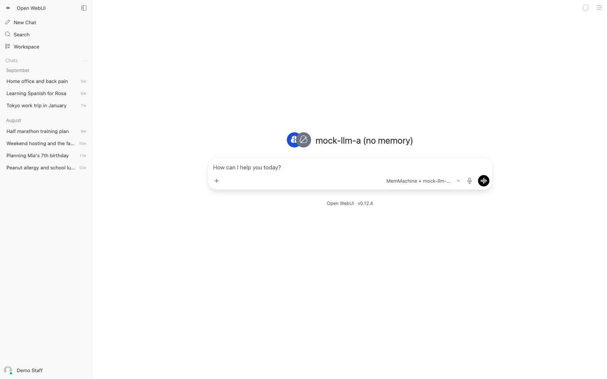
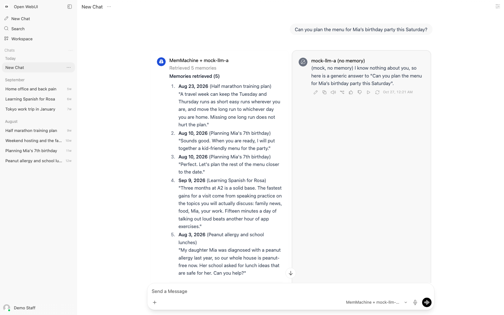
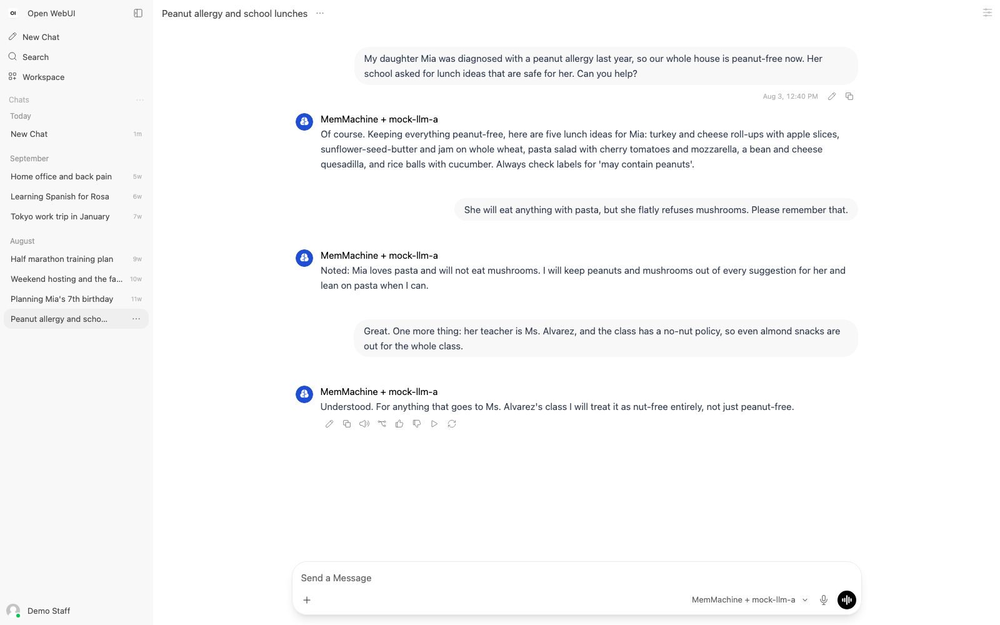
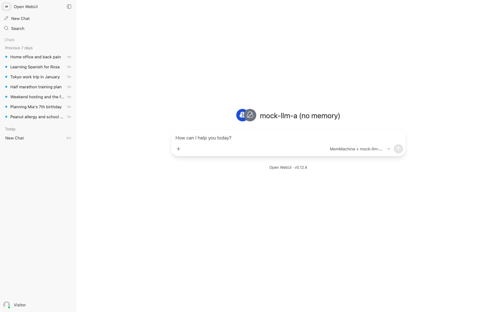
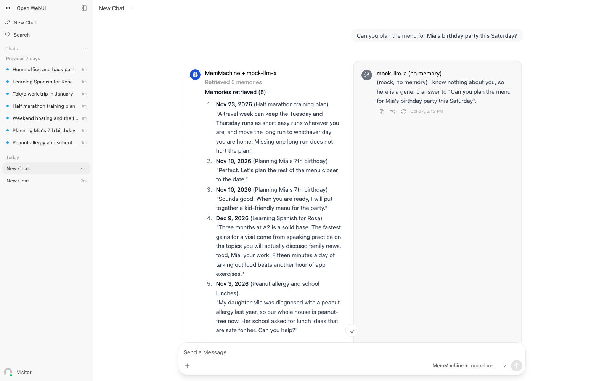
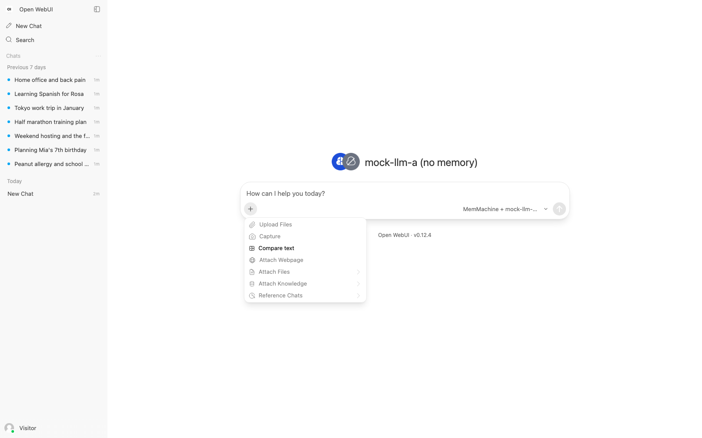

# CES 2027 데모 Mac 검증 기록

- 날짜: 2026-10-27
- 환경: MacBook(16GB, Docker VM 8GB, immich 등 다른 컨테이너 동작 중), Docker 29.4, Compose v5.1, Python 3.14. LLM과 임베더는 `mock/`의 가짜 서버.
- 대상 커밋: `msr_ces2027_demo` 브랜치의 `c3a33300`까지.
- 방법: [사용 가이드](guide_2026-10-27.md) 2장을 처음부터 그대로 따랐다. `docker compose --profile local down -v`로 볼륨까지 지운 뒤 올렸다.

## 1. 요약

가이드 2장의 명령이 순서대로 모두 통과했다. 볼륨 삭제부터 검사 통과까지 1분이 걸렸다(이미지는 미리 받아 둔 상태). 비교 화면에 왼쪽 목록과 답, 오른쪽 기억 없는 답이 설계 시안대로 나오고, 사이드바의 과거 채팅을 열면 대본의 질문과 답과 시각이 그대로 있다. Mac에서 확인할 수 없는 것은 실제 임베더의 검색 품질(기대 문구가 top-5에 드는지)과 vLLM 두 대의 기동이며, 이 둘은 회사 검증 항목이다(README의 체크리스트).

## 2. 명령과 출력

### 2.1 스택 올리기

```
== 00:25:01 down -v
 Volume deploy_qdrant_data Removed
 Volume deploy_openwebui_data Removed
== 00:25:11 up --build --wait
 Container deploy-mock-1 Healthy
 Container deploy-qdrant-1 Healthy
 Container deploy-memmachine-1 Healthy
 Container deploy-postgres-1 Healthy
 Container deploy-openwebui-1 Healthy
SERVICE      STATUS
memmachine   Up 15 seconds (healthy)
mock         Up 15 seconds
openwebui    Up 15 seconds (healthy)
postgres     Up 15 seconds (healthy)
qdrant       Up 15 seconds
```

### 2.2 세팅, 적재, 검사

```
== 00:25:46 setup
signed in as staff@demo.local (admin)
function memmachine_pipe: created
function memmachine_pipe: enabled
model memmachine_pipe.mock-llm-a: created as 'MemMachine + mock-llm-a'
model mock-llm-a: created as 'mock-llm-a (no memory)'
account settings: release notes off, personal system prompt empty
done
== 00:25:47 load
project ces-20261027-002547: Pipe valve set, previous chats deleted
session 'Peanut allergy and school lunches': 6 turns, chat ce470a8f-...
session 'Planning Mia's 7th birthday': 6 turns, chat 821f8e39-...
session 'Weekend hosting and the family': 6 turns, chat 27bcb22e-...
session 'Half marathon training plan': 6 turns, chat a8285a20-...
session 'Tokyo work trip in January': 6 turns, chat 22b10618-...
session 'Learning Spanish for Rosa': 6 turns, chat ab751eaa-...
session 'Home office and back pain': 4 turns, chat ac906fbb-...
done. Reload the browser to see the chats.
== 00:25:49 check
OK   LLM server http://127.0.0.1:8000/v1: mock-llm-a, mock-llm-b
OK   embedding server http://127.0.0.1:8001/v1: mock-llm-a, mock-llm-b
OK   MemMachine: {"status": "healthy", "service": "memmachine", "version": "0.0.0"}
OK   Open WebUI: {"status": true}
OK   PostgreSQL port: 127.0.0.1:5432
OK   Qdrant port: 127.0.0.1:6333
OK   sign in to Open WebUI: staff@demo.local
OK   both demo models listed in Open WebUI: memmachine_pipe.mock-llm-a, mock-llm-a
OK   chat model served by the LLM server: mock-llm-a
WARN top-5 memories for 'Can you plan the menu for Mia's birthday party thi': missing ['dinosaurs', 'vegetarian'] among 5 retrieved
OK   top-5 memories for 'I am in Tokyo next week. How do I keep my training': 5 retrieved
WARN top-5 memories for 'What gifts should I bring for Kenji and for Rosa?': missing ['whisky', 'gardening'] among 5 retrieved
WARN top-5 memories for 'My right knee was sore again after yesterday's lon': missing ['kettlebell'] among 5 retrieved
     (mock embedder: expected phrases are matched by word overlap only; verify with the real embedder)
OK   record mode (RECORD_MEMORY) is off
OK   answer from the Pipe model: (mock, with memory) Using 5 memories. The first one says: [Nov 23, 2026 | Half m
all checks passed
```

`WARN` 세 줄은 mock 임베더가 단어 겹침으로만 검색하기 때문이며 실패로 세지 않는다. 형식 예시 대본(`script.sample.json`, 세션 셋)으로는 같은 검사가 전부 `OK`였다.

### 2.3 메모리

| 컨테이너 | 사용량 | 상한 |
|---|---|---|
| openwebui | 1.05GiB | 1.5GiB |
| memmachine | 267MiB | 1GiB |
| postgres | 86MiB | 512MiB |
| qdrant | 74MiB | 512MiB |
| mock | 33MiB | 256MiB |

## 3. 화면

headless Chromium(Playwright)으로 1600x1000에서 찍었다. Chrome 확장이 연결되지 않아 사람이 보는 브라우저 대신 썼다.

새 채팅 화면. 두 모델이 선택되어 있고(아바타 둘), 추천 프롬프트가 없다. 사이드바는 날짜를 석 달 당긴 대본 복사본으로 찍어 부스 시점처럼 월별로 묶인 모습이다. 실제 대본 날짜(11월과 12월)는 오늘 기준으로 미래라 "Previous 7 days"와 읽지 않음 점으로 보인다(설계 부록 A.22).



비교 화면. 왼쪽은 "Retrieved 5 memories" 상태와 날짜, 세션 제목이 붙은 목록 뒤에 mock의 "with memory" 답, 오른쪽은 기억 없는 답이다.



사이드바의 과거 채팅을 연 화면. 대본의 질문과 답이 그대로 있고, 메시지에 마우스를 올리면 시각이 보인다(브라우저의 시간대 기준).



## 4. 추가로 확인한 것

- LLM 서버를 끄면 모델 목록 조회가 1초 안에 끝나고 드롭다운에 `MemMachine pipe: cannot reach ...` 항목이 뜬다. 켜면 브라우저 새로 고침 뒤 복구된다.
- mock에 `[llm-error]`를 보내면 왼쪽 카드에 `LLM call failed: HTTP 500 ...`가 보인다.
- `RECORD_MEMORY`를 켜고 검사하면 `FAIL` 두 줄과 종료 코드 1이 나온다.
- 시간대: `.env`의 `TZ`를 서울로 두면 목록의 날짜가 서울 기준으로, LA로 두면 LA 기준으로 바뀐다.
- MemMachine 로그의 `No module named 'spacy'`는 쓰지 않는 retrieval agent의 선택 모듈이며 동작에 영향이 없다.
- 두 번 실행해도 결과가 같다. 세팅 스크립트는 `updated`를, 적재 도구는 새 프로젝트 ID를 찍는다.

## 5. 회사에서 확인할 것

README의 "회사에서 확인할 것" 목록 그대로다. 실제 임베더로 적재했을 때 네 질문의 기대 문구가 top-5에 드는지, vLLM 두 대가 뜨고 `dimensions` 재시도가 동작하는지, 답이 수 초 안에 시작하는지, vLLM 로그에 `tools`가 없는지를 보고 `verification_company_<날짜>.md`로 남긴다. 순서는 [회사 실행서](company_runbook_2026-10-27.md)에 있다.

## 6. 부스 계정 화면 (2026-10-27 추가)

같은 날 저녁, 부스 화면을 일반 계정으로 바꾼 뒤 다시 검증했다. 바뀐 것은 세 가지다. 세팅 도구가 부스 계정 `visitor@demo.local`(일반 사용자)을 만들고 두 모델 항목에 모든 계정의 읽기 권한을 준다. compose의 `USER_PERMISSIONS_CHAT_*`와 `ENABLE_SIGNUP=false`가 이 계정에 적용된다. 적재 도구는 채팅을 부스 계정 소유로 넣고, 검사 도구는 부스 계정으로 두 모델이 보이는지 본다. Open WebUI는 관리자에게 어떤 기능 제한도 적용하지 않으므로 관리자 계정(`staff@demo.local`)은 스크립트 전용이 됐다(설계 5.3절).

### 6.1 명령과 출력

`docker compose --profile local up -d --wait openwebui`로 환경 변수를 반영한 뒤 세 스크립트를 순서대로 실행했다. `WARN` 세 줄은 2.2절과 같은 이유다.

```
== 17:44:30 setup
signed in as staff@demo.local (admin)
function memmachine_pipe: updated
model memmachine_pipe.mock-llm-a: updated as 'MemMachine + mock-llm-a'
model mock-llm-a: updated as 'mock-llm-a (no memory)'
booth account visitor@demo.local: exists
account settings of staff@demo.local: release notes off, personal system prompt empty
account settings of visitor@demo.local: release notes off, personal system prompt empty
done
== 17:44:31 load
project ces-20261027-174431: Pipe valve set, previous chats of visitor@demo.local deleted
session 'Peanut allergy and school lunches': 6 turns, chat b65f4358-...
session 'Planning Mia's 7th birthday': 6 turns, chat 5fa5c210-...
session 'Weekend hosting and the family': 6 turns, chat 006c3e3c-...
session 'Half marathon training plan': 6 turns, chat bbc8d430-...
session 'Tokyo work trip in January': 6 turns, chat 64ec35ec-...
session 'Learning Spanish for Rosa': 6 turns, chat 7effcb92-...
session 'Home office and back pain': 4 turns, chat 8bb8bdb0-...
done. Reload the browser to see the chats.
== 17:44:31 check
OK   LLM server http://127.0.0.1:8000/v1: mock-llm-a, mock-llm-b
OK   embedding server http://127.0.0.1:8001/v1: mock-llm-a, mock-llm-b
OK   MemMachine: {"status": "healthy", "service": "memmachine", "version": "0.4.1.dev1"}
OK   Open WebUI: {"status": true}
OK   PostgreSQL port: 127.0.0.1:5432
OK   Qdrant port: 127.0.0.1:6333
OK   sign in to Open WebUI: staff@demo.local
OK   sign in as the booth account: visitor@demo.local
OK   both demo models visible to the booth account: memmachine_pipe.mock-llm-a, mock-llm-a
OK   chat model served by the LLM server: mock-llm-a
WARN top-5 memories for 'Can you plan the menu for Mia's birthday party thi': missing ['dinosaurs', 'vegetarian'] among 5 retrieved from ces-20261027-174431
OK   top-5 memories for 'I am in Tokyo next week. How do I keep my training': 5 retrieved from ces-20261027-174431
WARN top-5 memories for 'What gifts should I bring for Kenji and for Rosa?': missing ['whisky', 'gardening'] among 5 retrieved from ces-20261027-174431
WARN top-5 memories for 'My right knee was sore again after Sunday's long r': missing ['kettlebell'] among 5 retrieved from ces-20261027-174431
     (mock embedder: expected phrases are matched by word overlap only; verify with the real embedder)
OK   record mode (RECORD_MEMORY) is off
OK   answer from the Pipe model: (mock, with memory) Using 5 memories. The first one says: [Nov 23, 2026 | Half m

all checks passed
```

mock 로그의 `carries tools` 경고는 이 절의 화면 확인에서 보낸 질문까지 포함해 0건이다.

### 6.2 화면

부스 계정으로 들어간 새 채팅 화면. 입력창에는 `+` 단추, 모델 선택, 보내기 단추만 있다. 마이크, 음성 통화, 컨트롤 패널 단추가 없고, 사이드바에는 새 채팅, 검색, 과거 채팅 목록, 계정 메뉴만 있다.



비교 화면. 관리자 계정일 때와 같은 모양이며, 답 아래에는 복사, 포크, 재생성 아이콘과 시각만 남는다. 재생성은 시연 중 답이 나쁠 때 쓰려고 일부러 켜 두었다.



`+` 단추를 누른 모습. 첨부 관련 항목(Upload Files, Capture, Attach Webpage, Attach Files, Attach Knowledge, Reference Chats)은 모두 비활성이고 "Compare text"만 활성이다. 이 항목은 브라우저 안에서 글 두 개의 차이를 보여 주는 기능이라 모델에 아무것도 보내지 않는다. 프론트엔드가 `chat.compare` 권한 키를 보지만 v0.12.4 백엔드에는 그 키가 없어 끄는 설정이 없다.



### 6.3 남는 것과 사라진 것

사라진 것은 첨부(업로드 가능한 항목), 마이크, 음성 통화, 컨트롤 패널, 개인 시스템 프롬프트, 임시 채팅, 공유, 내보내기, 메시지 수정과 삭제와 평가와 이어쓰기, 가입 링크다. 남는 것은 `+` 단추(메뉴는 열리지만 Compare text 외에는 비활성), 답 아래의 복사, 포크, 재생성, "Merge Responses" 아이콘, 사이드바의 검색과 채팅 메뉴다. 이들을 숨기는 설정은 v0.12.4에서 찾지 못했다. 시연 중에는 누르지 않는 규칙으로 둔다.

세팅 도구를 고치면서 알게 된 것 하나를 적어 둔다. 모델 항목 갱신 API(`/api/v1/models/model/update`)는 읽기 권한(`access_grants`)을 건드리지 않는다. 권한은 `/api/v1/models/model/access/update`로 따로 넣어야 하며, 세팅 도구는 생성과 갱신 뒤에 항상 이 호출을 한다.


## 7. 기억 목록 두 줄, NOTE 블록, 임시 채팅 (2026-10-28 추가)

2026-10-28에 세 가지 요청(기억 목록이 자리를 너무 차지하니 기억마다 두 줄로, 기억 기반 답에 색을 입힐 수 있는지, 관객이 바뀔 때의 자동 초기화)을 반영하고 Mac에서 확인했다.

### 7.1 Open WebUI가 메시지 안에서 그릴 수 있는 것

시험용 채팅을 가져와서 어떤 마크업이 살아남는지 봤다(`img/10_markup_probe.png`, `img/11_alert_types.png`). 결과는 다음과 같다.

- `<span style>`, `<font color>`, `<mark>`, Tailwind 클래스를 단 `<span>`, `<div style>`는 모두 글자 그대로 보인다. Open WebUI가 메시지의 HTML 토큰을 이스케이프하기 때문이다. 따라서 답이나 목록의 글자 색을 Pipe가 바꿀 수는 없다.
- GitHub식 알림 블록 `> [!NOTE]`는 파란 세로 띠와 "NOTE" 제목으로, `[!TIP]`은 초록, `[!IMPORTANT]`는 보라, `[!WARNING]`은 노랑, `[!CAUTION]`은 빨강으로 그려진다. 제목 글자는 종류마다 고정이고 마커 뒤에 쓴 글은 본문으로 들어간다. 모르는 종류(`[!MEMORY]`)는 보통 인용으로 그려진다. 블록 안의 번호 목록과 굵은 글씨는 정상이다.
- `<details>`는 접힌 상자로, `<details type="reasoning">`은 "Thought for less than a second"로 그려진다. 둘 다 기억을 숨기므로 쓰지 않는다.

그래서 기억 목록을 `> [!NOTE]` 블록으로 감쌌다(Pipe 0.2.0). 답의 색은 바꾸지 않는다.

### 7.2 임시 채팅

관객의 질문이 사이드바에 쌓이지 않게 하는 방법 둘을 시험했다.

- `USER_PERMISSIONS_CHAT_TEMPORARY_ENFORCED=true`: 질문은 저장되지 않고 사이드바도 그대로지만, 그 상태에서 부스 계정의 채팅 가져오기가 `HTTP 403`으로 막힌다(`models/chats.py`의 `require_chat_creation_permission`). 적재 도구가 동작하지 않으므로 쓰지 않는다. `ENABLE_PERSISTENT_CONFIG=false`에서는 `Config.get`이 환경 변수 값만 돌려주므로 관리자 API로 잠시 푸는 것도 안 된다.
- 계정 설정 `ui.temporaryChatByDefault=true`(권한 `USER_PERMISSIONS_CHAT_TEMPORARY`는 허용): 로그인 직후, 질문 뒤, New Chat 뒤, 새로 고침 뒤, 과거 채팅을 열었다 New Chat으로 돌아온 뒤 모두 "Temporary Chat" 표시가 있고 채팅 수는 7개 그대로였다. 가져오기도 정상이다. 세팅 도구가 두 계정에 이 설정을 쓴다.

화면 오른쪽 위에 임시 채팅을 끄는 단추가 하나 생긴다. 관객이 누르면 그 채팅은 저장되지만 New Chat을 누르면 다시 임시 채팅으로 돌아온다. 사이드바에 남은 채팅은 적재 도구를 다시 실행하면 지워진다.

### 7.3 최종 확인

세팅, 적재, 검사 스크립트를 다시 실행해 전부 통과했다(mock 임베더의 기대 문구 WARN은 6장과 같다). 부스 계정 화면의 캡처는 다음과 같다.

- `img/07_booth_new_chat_temporary.png`: 새 채팅. 두 모델이 선택되어 있고 위에 "Temporary Chat" 표시가 있다.
- `img/08_booth_comparison_callout.png`: 첫 질문의 비교 화면. 왼쪽은 파란 NOTE 블록 안에 기억 다섯 개가 본문 두 줄씩(80자에서 단어 경계로 자르고 "...") 나오고 구분선 아래에 답이 있다. 목록 항목의 높이는 네 개가 73px(날짜 줄 하나와 본문 두 줄)이고, 세션 제목이 길어 날짜 줄이 둘로 접힌 하나가 98px이었다.
- `img/09_booth_after_new_chat.png`: New Chat을 누른 뒤. 사이드바는 과거 채팅 일곱 개 그대로이고 질문 채팅은 남지 않았다.

두 줄은 1600px 너비 창의 비교 화면 기준이다. 시연 장비에서 한 줄에 들어가는 글자 수가 다르면 Valve `MEMORY_PREVIEW_CHARS`로 맞춘다.
